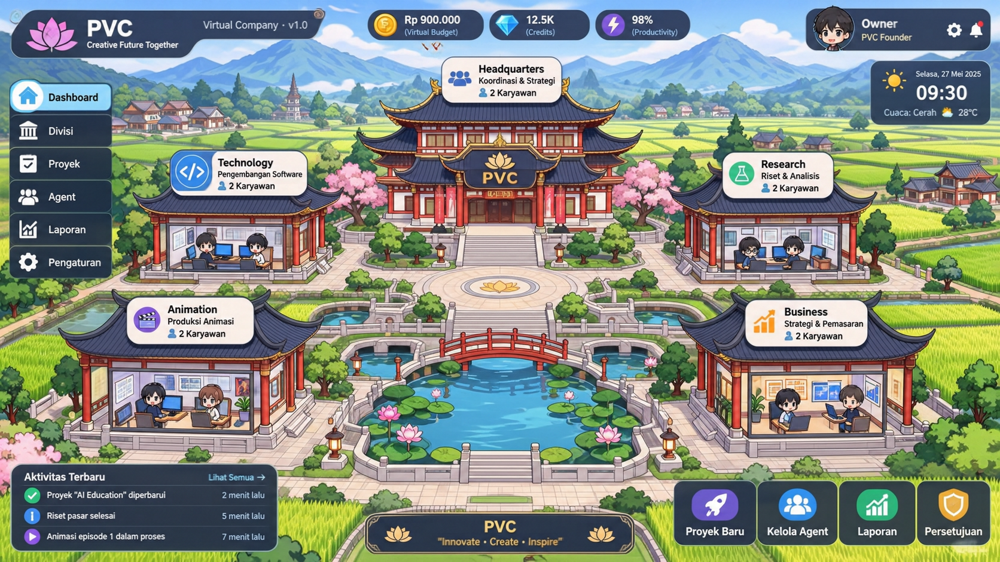

# PVC Virtual Company — Blueprint v1.0 Implementation

> **Satu perusahaan virtual** dengan kampus 2D bergaya tradisional Tiongkok di tengah persawahan asri. Dikelola manusia sebagai **Founder/Owner** dan dijalankan oleh **10 agent AI** lintas 5 unit organisasi untuk produksi software & animasi 2D.



> Visual kampus: Headquarters di pusat + 4 gedung departemen (Technology, Research, Animation, Business) — arsitektur atap melengkung kerajaan Tiongkok, dikelilingi sawah terasering.

## 🏯 Struktur Kampus Virtual

| Bangunan | Fungsi | Agent Awal (2) |
|---|---|---|
| **Headquarters** | CEO, koordinasi, monitoring, approval | AI CEO + AI Project Manager |
| **Technology** | App dev, backend, frontend, QA | Developer + QA Engineer |
| **Research** | Riset teknis/pasar, analisis | Researcher + Analyst |
| **Animation** | Naskah, storyboard, animasi 2D | Storyboard Artist + 2D Animator |
| **Business** | Strategi, marketing, distribusi | Strategist + Marketing |

*Kapasitas awal 2 agent/gedung — dapat bertambah logis tanpa menambah bangunan fisik (Blueprint §3).*

## 🏗️ Arsitektur Teknis

```
Frontend:    Next.js 14 + TypeScript + Tailwind (dashboard + peta kampus 2D SVG)
API:         Vercel Functions / Next.js API Routes
Orchestrasi: LangGraph.js + Agent Loop (Plan→Act→Observe→Evaluate, max 5 iterasi)
Model Router: Adapter free-only (Gemini, Groq, OpenRouter) — NO silent fallback ke berbayar
Database:    Supabase Postgres + Storage + RLS
Sandbox:     Worker terisolasi untuk build/test/render panjang
Integrasi:   GitHub API (read-only awal, merge/deploy butuh approval RED)
```

Lihat [docs/architecture/overview.md](docs/architecture/overview.md) untuk diagram lengkap.

## 🚦 Matriks Izin Tindakan (Blueprint §4.1)

| Level | Contoh | Kebijakan |
|---|---|---|
| 🟢 **GREEN** | Riset, ringkasan, draft, analisis | Otomatis + audit log |
| 🟡 **YELLOW** | Branch, edit sandbox, buat aset, test | Allowlist repo, batas waktu/biaya |
| 🔴 **RED** | Merge production, deploy, publikasi, hapus data | **Wajib approval Owner** |

## 🔄 Alur Kerja (Blueprint §5)

```
Instruksi Owner → AI CEO → PM (pecah tugas) → Router → Dept Executor (parallel) → QA → Approval (jika RED) → Delivery
```

Setiap tahap menghasilkan audit trail, checkpoint untuk resume, dan status yang tercermin di lampu gedung & avatar.

## 📦 Struktur Monorepo (Blueprint §16)

```
pvc/
├── apps/web/              # Next.js dashboard + campus 2D
├── packages/
│   ├── company-core/      # company, departments, agents, permissions
│   ├── agent-runtime/     # Agent Loop
│   ├── workflow-engine/   # LangGraph graphs & state
│   ├── model-router/      # provider adapters free-only
│   ├── database/          # schema, migrations, Supabase
│   └── shared/            # types, Zod schemas
├── workers/render-worker/ # render/build jobs terisolasi
├── tests/                 # unit / integration / e2e
└── docs/
```

## 🚀 Quick Start

```bash
# 1. Install
npm install

# 2. Env
cp .env.example .env.local
# isi NEXT_PUBLIC_SUPABASE_URL, NEXT_PUBLIC_SUPABASE_ANON_KEY,
# SUPABASE_SERVICE_ROLE_KEY, GITHUB_TOKEN (opsional)

# 3. Database (Supabase)
npm run db:migrate
npm run db:seed

# 4. Dev
npm run dev
# buka http://localhost:3000
```

Deploy ke Vercel: hubungkan repo → set env vars → deploy. Worker render jangan di Vercel Functions (timeout), jalankan terpisah.

## 🎨 Visual → Data (Blueprint §9.1)

| Elemen Visual | Sumber Data |
|---|---|
| Lampu/status gedung | Agregasi status agent & task departemen |
| Avatar di meja | Agent terdaftar; idle/working/waiting sesuai `status` |
| Balon aktivitas | Task aktif / event terbaru (bukan teks acak) |
| Klik gedung | Buka halaman departemen + daftar agent |
| Klik avatar | Buka profil agent + pekerjaan aktif |

> MVP: satu scene kampus responsif dengan hotspot SVG, bukan game engine. Mobile-friendly.

## 🧪 MVP Checklist (Blueprint §13-14)

- [x] 1 company, 5 units, 10 agent seeds
- [x] Agent registry + Task board (Backlog→Done)
- [x] LangGraph workflow + checkpoint/resume
- [x] Model Router free-only (hard stop, bukan fallback berbayar)
- [x] Approval gate untuk RED
- [x] Campus 2D klik → data nyata
- [x] RLS, audit log, RBAC
- [x] Test: lifecycle, recovery, provider limit, approval, sandbox

## 📄 Dokumen

- [Blueprint PDF asli](docs/Blueprint_PVC_Virtual_Company_v1.0.pdf) — sumber kebenaran
- [Arsitektur](docs/architecture/overview.md)
- [Database ERD](docs/architecture/database.md)
- [Keputusan desain](docs/decisions/ADR-001-stack.md)
- [Runbook](docs/runbooks/local-dev.md)

## ⚠️ Catatan

Blueprint v1.0 adalah rancangan konseptual. Implementasi ini mengunci skema final saat migrasi. Tidak ada klaim kuota provider sebelum benchmark.

---
Built with ❤️ for PVC Founder — *keterlacakan > jumlah avatar.*
